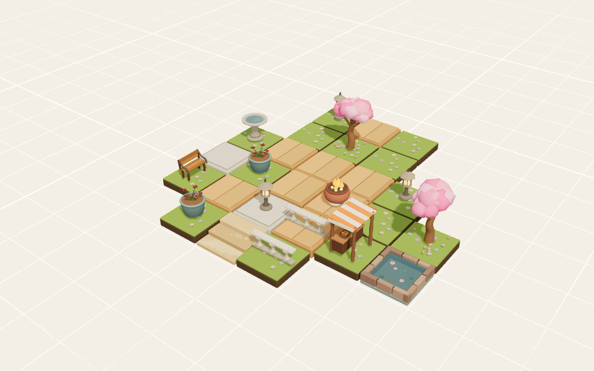
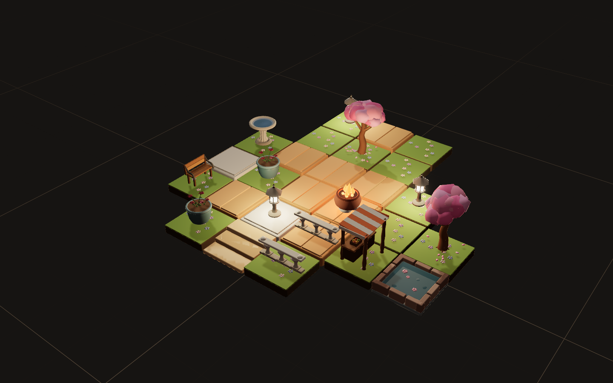
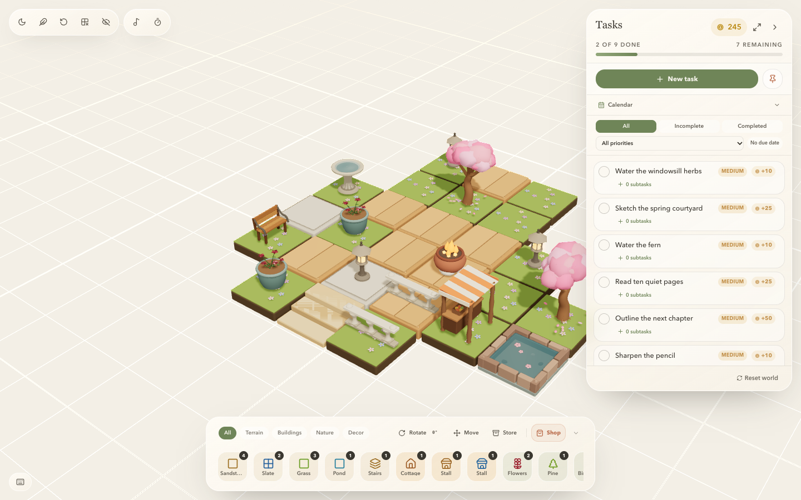
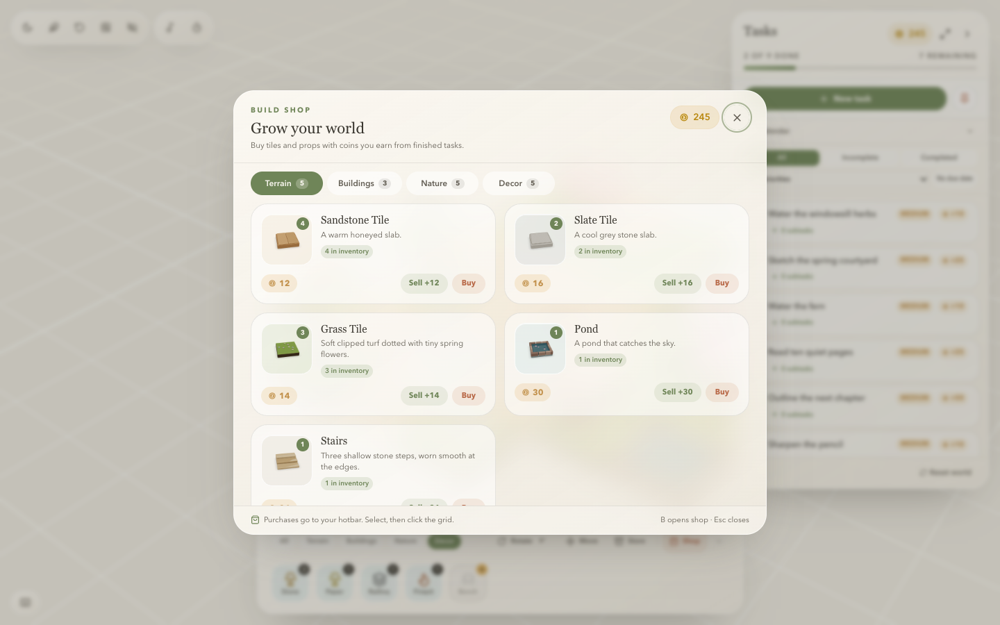
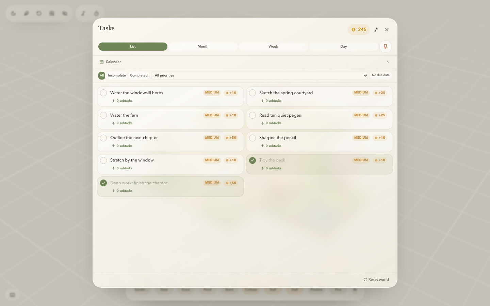
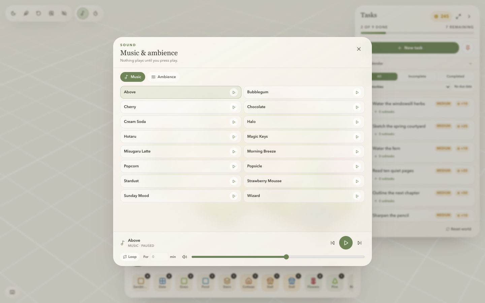
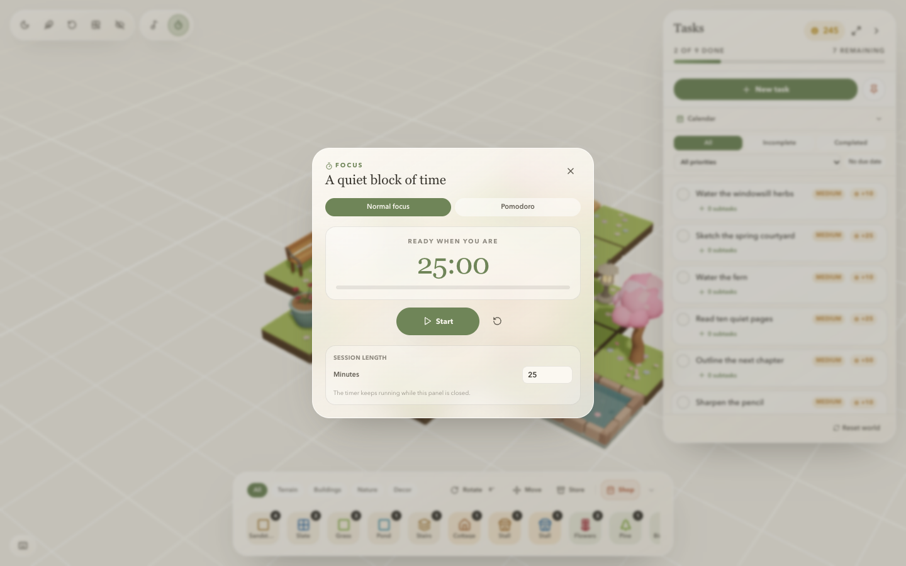

<div align="center">
  
  <h1>Evergrow</h1>
  <p><strong>A cozy 3D isometric miniature diorama that grows from the real-life tasks you finish.</strong></p>
  <p>
    <a href="https://github.com/yx0128/evergrow-v1/actions"></a>
    
    
    
    
    
    <a href="https://yx0128.github.io/evergrow-v1/"></a>
  </p>
</div>

## Live demo

**<https://yx0128.github.io/evergrow-v1/>**

No install required. The demo is a static build deployed from `main` by GitHub Actions; all state stays in the visitor's browser.

## The idea

Finish a small task, earn coins, and place a hand-sculpted miniature into a floating world in space. Every tile is `1×1`; every prop is art, not an emoji. Plan with a task bar or a full-screen task tab, add calm music or ambience, and settle into a normal or pomodoro focus session. The world is quiet, tactile, and deliberately low-pressure.

- **Task → coin loop.** Quick tasks pay `10`, standard tasks `25`, deep work `50`. Completion is one-way, so the economy cannot be farmed by unchecking. Tasks can carry checklists of subtasks, priority levels, and deadlines; subtasks show progress bars and are editable inline. The list sorts by completion, due date, then priority, and filters by status, priority, exact date, date range, or no due date.
- **Task bar or full tab.** Keep a compact task bar docked to the right, or open the same plan as a full-screen tab with List, Month, Week, and Day calendars. Create tasks in the bar; drag task cards between days to reschedule them.
- **Sound and focus.** A built-in music and ambience player plays only after you press play, with track skipping, optional looping and loop duration, volume, and mute. Normal and pomodoro focus timers keep running when their panel is closed and chime when a block ends.
- **Two-layer building.** Place base tiles on empty cells, then place surface props on top of a base tile. Props never float and never share a cell. Click a placed piece to select it in place: `R`/HUD **Rotate** reorients it, **Move**/`M` lifts it for repositioning, and HUD **Store** returns it to inventory. A base tile carries its prop along.
- **Real `.glb` engine.** Sixteen Blender-sculpted GLB miniatures are loaded at runtime, auto-normalized to a `0.96` footprint, auto-grounded, and shadow-enabled.
- **Performance-minded.** Placed tiles and props render through instanced batches, ten pooled point lights keep the shader light count fixed, and a saved High/Low graphics toggle lazy-loads post-processing only when needed.
- **Day and night.** Warm cream daylight with clean negative space; a charcoal starfield with moonlight, lantern point lights, firepot glow, subtle bloom, and ACES tone mapping.
- **Desktop-first HUD.** Glass task bar/tab, a category-filtered hotbar (Terrain, Nature, Decor, Buildings) with a compact Rotate/Move/Store/Shop rail, build shop (`B`), photo mode (`H`), and a camera reset that always brings you home.
- **No backend.** No accounts, analytics, network calls, or API keys. Only `localStorage` — validated on read.

## Screenshots

| Daylight courtyard | Night garden |
| --- | --- |
|  |  |

| Full interface | Build shop |
| --- | --- |
|  |  |

| Task tab | Sound player | Focus session |
| --- | --- | --- |
|  |  |  |

## Quick start

Requirements: **Node.js 20+**, **npm 10+**. Regenerating art additionally needs **Blender 4.2+** (tested with 5.3).

```bash
git clone https://github.com/yx0128/evergrow-v1.git
cd evergrow-v1
npm install
npm run dev
```

Open the URL printed by Vite (default `http://localhost:5173`). A fresh save starts empty: no coins, no tasks, and no placed pieces. Add a task, finish it, and spend the reward on your first tiles. For the hosted copy, see the [live demo](https://yx0128.github.io/evergrow-v1/).

```bash
npm run typecheck
npm run lint
npm test
npm run build
npm run preview
```

## Controls

| Input | Action |
| --- | --- |
| Left click | Place the selected item on a valid cell |
| Left click a placed piece | Select it in place (sage ring + selection pill) |
| Task **New task** | Open the task dialog to set size, priority, deadline, and subtasks |
| Task title | Expand deadline and priority editing |
| Task **N subtasks** | Expand the checklist; click a subtask title to edit it |
| Task layout button | Dock as a side bar or open as a full tab |
| Drag a task card (Month/Week) | Move the task to another due date |
| Top bar **Music** | Open the music and ambience player |
| Top bar **Timer** | Open the focus session panel |
| Pin beside **New task** | Pin or unpin every unfinished task at the top |
| Pin on a task row (hover) | Pin or unpin that unfinished task |
| `1`–`9` | Select a slot in the active hotbar category |
| `[` / `]` | Previous / next hotbar category |
| `R` or HUD **Rotate** | Rotate placement, the selected piece, or a lifted piece in 90° steps |
| `M` or **Move** | Lift the selected piece; click a valid cell to drop it |
| Right click a piece | Return it to inventory |
| HUD **Store** | Store the selected piece, or toggle click-to-store mode when nothing is selected |
| HUD **High / Low** | Toggle graphics quality; Low disables post-processing, caps DPR at 1.25, and uses 1024px shadows |
| Right drag | Orbit the camera |
| Middle drag | Pan the camera |
| Wheel | Zoom |
| `B` | Open or close the build shop |
| `Esc` | Cancel/deselect / close the shop / clear store mode |
| `H` | Photo mode (hide HUD); press again to return |
| HUD **Reset Camera** | Return to the reference isometric view |
| Task **Reset world** | Two-click reset back to an empty world |

## Economy and catalog

| Tier | Reward |
| --- | ---: |
| Quick | 10 |
| Standard | 25 |
| Deep Work | 50 |

| Base tile | Cost | Surface prop | Cost |
| --- | ---: | --- | ---: |
| Sandstone Tile | 12 | Stone Lantern | 40 |
| | | Paper Lantern | 36 |
| | | Cottage | 175 |
| Slate Tile | 16 | Birdbath Fountain | 55 |
| Grass Tile | 14 | Balustrade | 22 |
| Pond | 30 | Firepit | 48 |
| Stairs | 34 | Flower Pot | 30 |
| | | Blossom Tree | 85 |
| | | Leafy Tree | 80 |
| | | Pine Tree | 90 |
| | | Orange Market Stall | 110 |
| | | Blue Market Stall | 115 |
| | | Bench | 32 |

## Real sculpted GLB art

All sixteen miniatures are authored by `scripts/generate_models.py` through Blender's Python API. The script uses bevels, subdivision, lathe profiles, bmesh jitter, layered rose petals, flame profiles, and Principled BSDF materials. Lantern cores and flames use emission strength `4.0` so the WebGL bloom pass catches them at night.

```bash
# Blender on PATH
blender --background --python scripts/generate_models.py

# macOS app bundle
/Applications/Blender.app/Contents/MacOS/Blender --background --python scripts/generate_models.py

# or use the cross-platform wrapper (honours BLENDER_BIN)
npm run models
```

Outputs are written to `public/models/*.glb`. Each model is centered on X/Z, grounded at `Z = 0` in Blender, and exported with `export_yup=True` and `export_apply=True`. At runtime, `<MiniatureModel />` measures the GLB, scales the largest horizontal edge to `0.96` world units, grounds the bounding box to `y = 0`, and enables `castShadow`/`receiveShadow`. Base tiles receive a tiny vertical height lock so their surface stays exactly at `y = 0.2333`; props sit flush there.

See [docs/ART_PIPELINE.md](docs/ART_PIPELINE.md) for the coordinate contract, material rules, and per-model notes.

## Architecture at a glance

```text
src/
  components/canvas/   Three.js scene, diorama, GLB loader, camera
  components/ui/       Top bar, task bar/tab, calendar views, audio, focus, hotbar, shop
  data/items.ts        Catalog, costs, rewards, priority labels
  hooks/               Audio player and focus-session state
  lib/                 Grid, dates, calendar, task/focus helpers, sound, IDs
  store/               Zustand store + validated localStorage persistence
  test/                Vitest suites for store, tasks, calendar, focus, audio, hotbar
scripts/
  generate_models.py   Blender-authored GLB pipeline
  generate_models.sh   Blender launcher
public/models/         16 committed GLB assets
docs/                  Architecture, art, QA, reproduction, design
skill/                 Portable AI-agent skill backup
```

Key contracts:

- Store key `evergrow-v1`, version `1`.
- Persisted fields only: `coins`, `tasks`, `inventory`, `placedItems`, `themeMode`, `graphicsQuality`, `taskLayout`.
- `placedItems` are validated on every read: known item IDs, integer cells, unique cells per layer, and props require a base tile.
- One invisible `220×220` raycast plane receives clicks for both layers; placed pieces stop propagation so right-click storage is reliable.
- Camera: `fov 32`, position `[7.4, 8.4, 9.6]`, target `[0, 0.2333, 0]`, right-drag orbit, clamped polar angle.
- Effects: lazy-loaded Bloom (`luminanceThreshold 1.1`, intensity `0.45`) + ACES Filmic tone mapping. No AO, hue/saturation, brightness/contrast, or vignette, so High-quality colors match Low; lantern glow panels and firepot flames use a warm golden-yellow emissive in every mode, keeping them visible day and night.
- Lights: ten permanent pooled point lights; day sets all to zero, night assigns the ten nearest lanterns/firepots.

Read [docs/ARCHITECTURE.md](docs/ARCHITECTURE.md) for the full data flow and invariants.

## Documentation

- [Architecture](docs/ARCHITECTURE.md) — data model, grid rules, renderer, persistence, instancing, light pool, quality presets.
- [Art pipeline](docs/ART_PIPELINE.md) — Blender script, materials, model specs.
- [Design contract](docs/DESIGN.md) — palette, layout, camera, motion.
- [QA playbook](docs/QA.md) — automated interaction checks and visual QA.
- [Reproduction guide](docs/REPRODUCTION.md) — build the whole project from an empty directory.
- [Agent guide](docs/AGENT_GUIDE.md) — concise handoff for AI coding agents.
- [Release checklist](docs/RELEASE_CHECKLIST.md) — publish and verify.
- [Session state](STATE.md) — time, token usage, model, and credits for the build session.
- [Skill backup](skill/evergrow-diorama/SKILL.md) — reusable agent playbook, also published at [evergrow-diorama-skill](https://github.com/yx0128/evergrow-diorama-skill).

## Quality gates

```bash
npm ci
npm run typecheck
npm run lint
npm test        # 61 tests
npm run build
```

Visual QA is mandatory. `docs/qa/visual-check.mjs` drives headless Chrome at `1440×900`, seeds a rich world, exercises tasks, purchase, placement, select/rotate, moving, and persistence, and captures the screenshots used above. The sound and focus panels are captured for the README alongside the world and shop views.

## Deployment

Pushes to `main` deploy the production build to GitHub Pages via [`.github/workflows/pages.yml`](.github/workflows/pages.yml). The workflow sets `VITE_BASE_PATH=/<repository-name>/`, so assets and GLBs resolve correctly under the project subpath. To reproduce the hosted build locally:

```bash
VITE_BASE_PATH=/evergrow-v1/ npm run build
npm run preview -- --port 4183 --base /evergrow-v1/
# open http://localhost:4183/evergrow-v1/
```

## Credits

Built in a single session with **[OpenCode](https://opencode.ai)** running the model **`opencode-go/deepseek-v4.1-flash`**. Art and code were generated by the agent and verified with TypeScript, ESLint, Vitest, Vite, and headless Chrome.

Standing on the shoulders of:

- [React](https://react.dev), [Vite](https://vite.dev), [TypeScript](https://www.typescriptlang.org)
- [Three.js](https://threejs.org), [@react-three/fiber](https://docs.pmnd.rs/react-three-fiber), [@react-three/drei](https://github.com/pmndrs/drei), [@react-three/postprocessing](https://github.com/pmndrs/react-postprocessing), [n8ao](https://github.com/n8ao/n8ao)
- [Zustand](https://zustand.docs.pmnd.rs), [Tailwind CSS](https://tailwindcss.com), [lucide-react](https://lucide.dev)
- [Blender](https://www.blender.org)

The cozy miniature tone is inspired by the broader genre of garden diorama games; this is an original implementation with original sculpted assets.

## License

[MIT](LICENSE) © 2026 Evergrow contributors.
